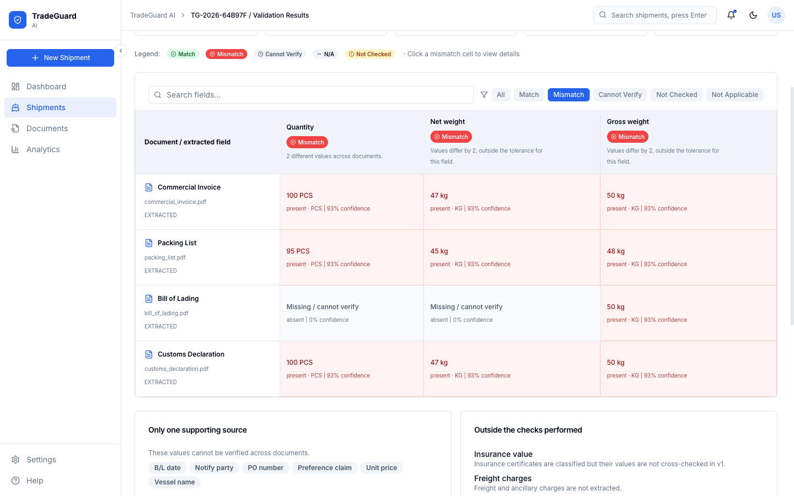
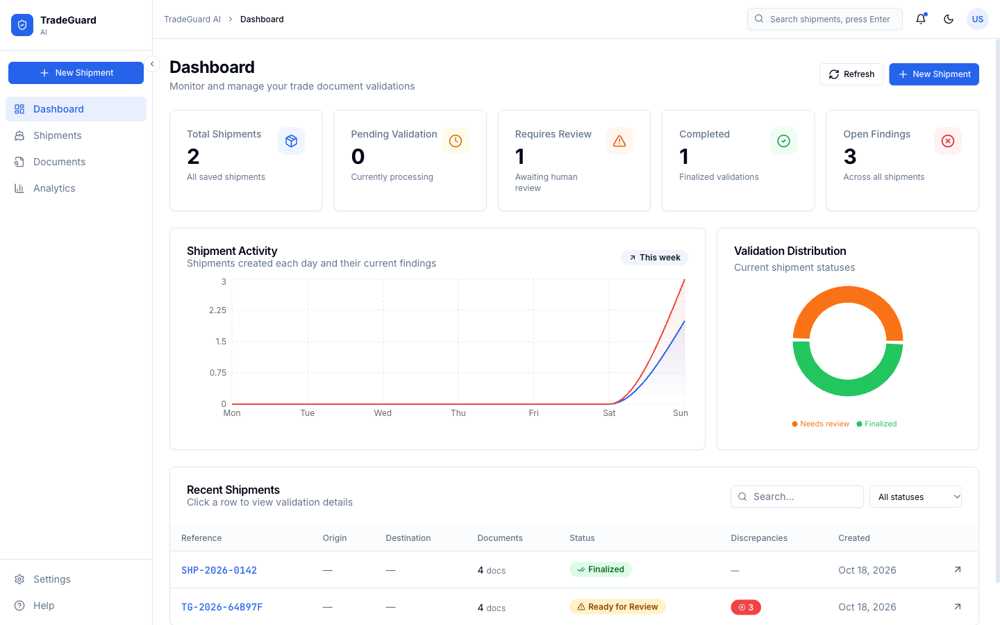
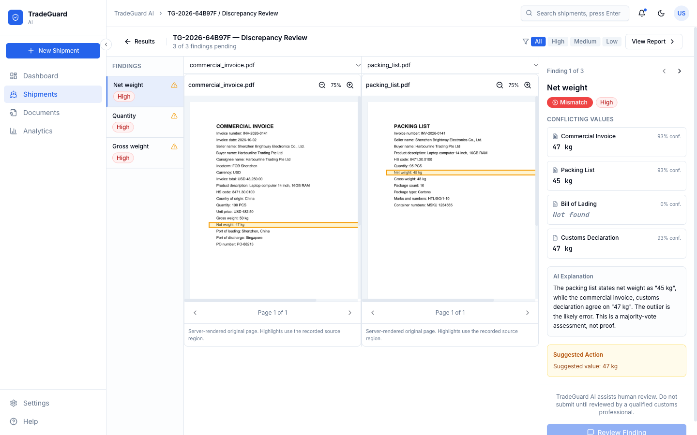
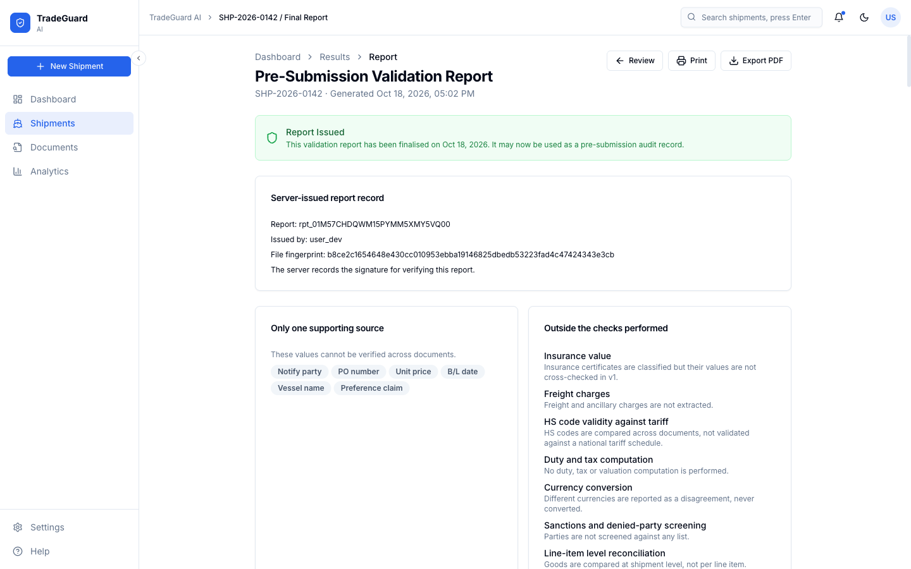
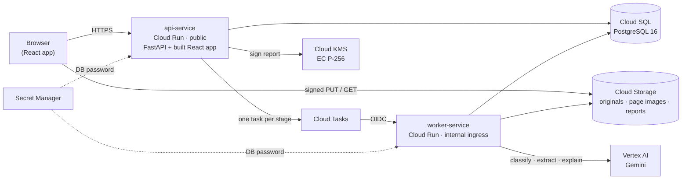
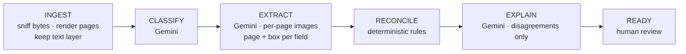

# TradeGuard AI: cross-document trade file pre-validation

**Upload the document set for a shipment. Get back a field-by-field agreement matrix showing exactly where the documents contradict each other, with every finding traced to the source page, and a human decides before anything is filed.**

Built for the **AI Builder Cup 2026** (Hack2skill × Google Cloud), Theme 3: *Manufacturing: Intelligent Operations & Industrial Efficiency*.



---

## The problem

A single international shipment produces six or more documents: commercial invoice, packing list, bill of lading or air waybill, certificate of origin, purchase order and customs declaration. Different parties write them, in different systems. They must agree on quantities, values, weights, HS codes, consignee and Incoterms, but **nobody checks that they agree until customs or a bank does**. When they disagree, cargo is held, clearance is delayed, or payment stalls. Today a person does this reconciliation by reading documents side by side.

> *"If we could automate one thing, it would be pre-validation checks that catch mismatches before submission."*
> (freight forwarding operation at JNPT, India, r/freightforwarding, April 2026)

For context, the ICC Banking Commission (Technical Advisory Briefing No. 3, 2022) estimates that **65–80% of documents presented under letters of credit are refused on first presentation**, and names "conflicting data between documents" among the common discrepancies. That figure is an expert estimate, not a measured survey, and refusal is not non-payment.

**What we build: the check that happens before submission, not after rejection.** The full research, sources and the figures we deliberately do *not* use are in [PROBLEM-STATEMENT-trade-document-prevalidation.md](PROBLEM-STATEMENT-trade-document-prevalidation.md).

## What it does

| Step | What happens |
|---|---|
| **1. Intake** | Drop a shipment's files: PDF, scans and photos (PNG, JPEG, TIFF, WEBP, HEIC) or XLSX. Up to 20 files, 50 MB each. Files go straight to Cloud Storage through short-lived signed URLs. |
| **2. Classify** | Each document's type is identified, duplicates are detected, and missing documents are flagged (e.g. no certificate of origin when a preference claim is made). |
| **3. Extract** | Gemini reads every page and returns each field with its value, **page, bounding box, confidence, model and prompt version**. |
| **4. Reconcile** | Deterministic code, not a model, compares every field across documents and produces the matrix. |
| **5. Explain** | For each disagreement, Gemini assesses which document is likely wrong and why, using only the conflicting values. |
| **6. Decide** | A human accepts, overrides (with a reason), flags for follow-up or dismisses (with a reason) **every** finding. |
| **7. Report** | A pre-submission report is generated and **signed with Cloud KMS**. It can only be issued once every finding has a decision. |
| **8. Loop** | An approval-effectiveness view reports how often reviewers follow or override the AI's assessment. |

### Screenshots
*Captured from a local run of this repository with sample shipment documents.*

| Dashboard | Discrepancy review with source highlights |
|---|---|
|  |  |

| Signed pre-submission report |
|---|
|  |

## Design principles

These come from the research and are enforced in code, not just in copy.

1. **The system never files anything.** It produces findings. There is no code path that submits to a customs authority or bank, and a report can only be issued from the `REVIEWED` state.
2. **"Cannot verify" is a first-class result.** It is never shown as agreement.
3. **Agreement needs two sources.** A field carried by only one document is `SINGLE_SOURCE` and is never green.
4. **The comparison is code, not a model.** Whether two HS codes share a heading, or whether `48,250.00` equals `48250.00`, is decided by deterministic rules. The model reads documents and explains findings.
5. **Re-performability.** Every value records which document, page and region it came from, which model and prompt version read it, when, and at what confidence.
6. **What was not checked is shown as prominently as what was.** Out-of-scope fields, single-source fields, unreadable documents and missing documents are all listed.
7. **Every decision is audited.** An append-only, hash-chained audit log is enforced by a database trigger.

### Verdicts

| Verdict | Meaning |
|---|---|
| `AGREE` | Two or more documents carry the field and their normalised values match |
| `AGREE_AT_HS_ROOT` | HS codes share the 6-digit heading; national extensions differ (e.g. 10 vs 12 digits). Still needs a decision |
| `TOLERANCE_MATCH` | Numeric values differ within the field's tolerance. Still needs a decision |
| `DISAGREE` | The documents conflict (blocking) |
| `SINGLE_SOURCE` | Only one document carries the field, so nothing was cross-checked |
| `CANNOT_VERIFY` | Expected but absent, unreadable, ambiguous (e.g. a DD/MM vs MM/DD date) or below the confidence floor |
| `NOT_APPLICABLE` | Not expected in the uploaded document types |

Different currencies are always a disagreement and are never converted.

## Architecture



- **One codebase, two Cloud Run services.** `SERVICE_ROLE=api` serves the public API and the built frontend from one URL. `SERVICE_ROLE=worker` runs pipeline stages pushed by Cloud Tasks; it has internal ingress and checks an OIDC token.
- **Gemini runs inside the worker.** There is no separate AI service to deploy or secure.
- **Progress** is persisted per stage, fanned out with Postgres `LISTEN/NOTIFY`, and polled by the UI.

### The pipeline



Each stage is idempotent and retried by Cloud Tasks. **Partial success is success**: a corrupt or password-protected file is reported as unchecked, and the rest of the shipment is still analysed.

### How the AI is used

- **API surface:** the Interactions API (`GEMINI_API=interactions`), with `generate_content` available as a switch. Requests set `store=False`, because trade documents are commercially sensitive.
- **Model rules:** flat, closed response schemas. Temperature is never set. `thinking_level` is used only, never together with a thinking budget.
- **Page images:** each page is sent as a separately labelled image, so the page index is known by construction. Gemini's `[ymin, xmin, ymax, xmax]` 0–1000 boxes are converted to `[x0, y0, x1, y1]` 0–1 in exactly one function, which a test guards against axis transposition.
- **Confidence** blends the model's self-report with whether the value appears in the PDF's own text layer and whether it parses. A value the text layer doesn't contain drops below the confidence floor instead of looking certain.
- **Failure handling:** retries with jitter, one schema-repair attempt, and a token budget per run. An explanation failure never drops a finding.
- **Configuration:** the default model is `gemini-3.8-flash`, set with `GEMINI_MODEL`, `VERTEX_LOCATION` and `GEMINI_API`.

## Tech stack

| Layer | Technology |
|---|---|
| **AI** | Gemini on **Vertex AI** via `google-genai` |
| **Backend** | Python 3.12 · FastAPI · Pydantic 2 · SQLAlchemy 2 (async) + asyncpg · Alembic |
| **Documents** | pypdfium2 (rendering) · pypdf · Pillow + pillow-heif · openpyxl (XLSX) · reportlab (report PDF) · cryptography |
| **Frontend** | React 18 · TypeScript · Vite 7 · Tailwind CSS 3 · Radix UI · TanStack Query 5 · React Router 7 · axios |
| **Google Cloud** | Cloud Run · Cloud SQL (PostgreSQL 16) · Cloud Storage · Cloud Tasks · Cloud KMS · Secret Manager · Vertex AI · Cloud Build (buildpacks) · Artifact Registry · Cloud Logging |
| **Tooling** | uv · pytest · Vitest · ESLint · Playwright · openapi-typescript |

There are **no GPL or AGPL dependencies**; PyMuPDF and poppler are deliberately excluded. **No Docker** is used: deploys are Cloud Run source deploys with buildpacks.

## Repository layout

```
backend/     FastAPI api-service + worker-service, AI layer, migrations, tests, scripts
frontend/    React + TypeScript app
contracts/   openapi.yaml (generated from the backend) and AI request/response examples
infra/       setup.sh (one-time GCP setup) and deploy.sh (build + deploy)
docs/images/ screenshots used in this README
```

## Run locally

Prerequisites: Python 3.12 with [uv](https://docs.astral.sh/uv/), Node.js, and PostgreSQL 16. No cloud account is needed: local mode uses a deterministic AI stub, local storage and a local signing key.

```bash
# PostgreSQL (macOS / Homebrew)
brew install postgresql@16 && brew services start postgresql@16
psql -d postgres -c "CREATE ROLE tradecheck LOGIN PASSWORD 'tradecheck' CREATEDB;"
psql -d postgres -c "CREATE DATABASE tradecheck OWNER tradecheck;" -c "CREATE DATABASE tradecheck_test OWNER tradecheck;"

# Backend on :8080
cd backend
uv sync --python 3.12
uv run alembic upgrade head
uv run python samples/generate.py          # sample shipments in samples/out/
uv run uvicorn app.main:app --port 8080

# Frontend on :5173 (proxies /api to :8080), in another terminal
cd frontend
npm ci
npm run dev
```

Open http://localhost:5173. There is no sign-in; the app is usable immediately. Settings has a **Review role** switch (Approver / Owner / Viewer) that the server enforces.

To use Gemini locally instead of the stub: `gcloud auth application-default login`, then start the backend with `AI_MODE=vertex GCP_PROJECT=<project>`.

## Testing and evaluation

```bash
cd backend && uv run pytest        # 65 tests on real PostgreSQL
cd frontend && npm test && npm run lint && npm run build && npm run check:api
```

- **Backend tests cover:**
  - the pipeline over 10 sample scenarios
  - the report gate, decisions and optimistic concurrency
  - the audit chain and its append-only enforcement
  - error envelopes, partial failures and the token budget
  - the Gemini bbox conversion
  - a full pipeline in Vertex mode with the model call faked
- **Frontend tests** cover backend response mapping, uploads, review versions, report download and uncertainty handling.
- **`backend/scripts/evaluate.py`** scores extraction and verdicts against ground truth. It reports **false agreement** (a real discrepancy reported as agreeing, the dangerous error) and **false alarm** separately. Each data split is reported on its own:
  - generated PDFs
  - simulated photos (`backend/eval/simulated_photos/`, made with Playwright; no text layer)
  - real photos

  The harness is validated in stub mode. Numbers with Gemini come from running it with `AI_MODE=vertex`.
- **`backend/scripts/vertex_smoke.py`** checks one document end to end against live Vertex AI.

## Deploy to Google Cloud

```bash
PROJECT=<project-id> ./infra/setup.sh     # once; every step checks first and skips what already exists
PROJECT=<project-id> ./infra/deploy.sh    # builds the frontend, deploys worker → runs migrations → deploys api
```

`deploy.sh` prints the public URL of `api-service`, which serves both the app and the API. Set `API_MIN_INSTANCES=1` before a demo to avoid cold starts.

## Limitations, stated plainly

- **No login.** This is an MVP: every visitor acts as the same workspace user. Approver and viewer roles are still enforced by the server. The approver recorded on every decision comes from the server-side identity, never from the request body.
- **Sample documents are synthetic.** Generated PDFs have a perfect text layer. Simulated photos remove it but are not real camera photos, so results on real scans should be measured separately.
- **Detection is not resolution.** The tool moves the discovery of a problem from *after* customs rejection to *before* submission. It cannot make a shipper reissue a corrected document.
- **Scope.** Line items, duty and tax, sanctions screening, tariff validity, insurance values, freight charges, currency conversion and signatures are explicitly **not** checked, and the app says so on every result.
